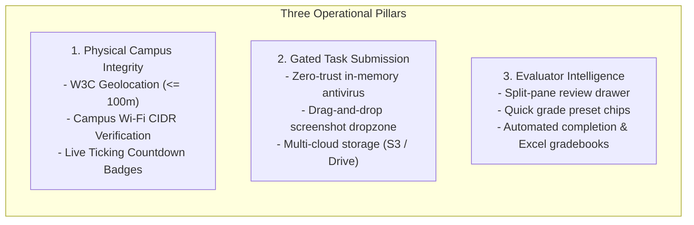

# Executive Summary: AR/VR Academy Platform Audit & Knowledge Extraction

**Document ID:** `EXEC-SUM-001`  
**Classification:** Executive Brief & System Assessment  
**Audit Date:** 2026-10-23T17:36:00+05:30  
**Target System:** AR/VR Academy Spatial Computing LMS (`LMS_System`)  
**Staging Host:** `https://arvr-academy-staging.onrender.com`  
**Repository Branch:** `staging` (`306fca7914b3ce6ca18eeedabf09628b9c3d19cb`)  

---

## 1. System Vision & Purpose

The **AR/VR Academy Platform** is an enterprise-grade training management system purpose-built for spatial computing, Unity XR, and immersive technology education. The system bridges physical campus presence with digital task verification, ensuring students complete practical XR development assignments under verified instructor supervision.

---

## 2. Key Audit Metrics & Technical Baseline

| Metric | Verified Value | Evidence |
| :--- | :--- | :--- |
| **Framework & Engine** | Next.js 16.3.2 (Turbopack) on React 19.2.8 | `package.json` |
| **Database System** | MongoDB Atlas Cloud Replica Set (3-Node) | `prisma/schema.prisma` |
| **Database Models** | 12 Collections (Student, Batch, Attendance, Evaluation, etc.) | Schema audit |
| **API Endpoints** | 52 Route Files / 69 Distinct Method Handlers | AST route audit |
| **Frontend Theme** | Royal Cobalt (`#2563EB`) & Electric Indigo (`#4F46E5`) | `app/globals.css` |
| **Test Suites** | 14 Specialized verification & torture test scripts | `scripts/*.ts` |
| **Security Score** | 0 Known Plaintext Secrets in bundles; 0 TypeScript errors | `npx tsc --noEmit` |

---

## 3. Core Architectural Highlights

1. **Zero-Trust File Upload Pipeline:** Every uploaded practical execution screenshot is buffered in memory and scanned against EICAR virus signatures, Windows MZ headers, and Linux ELF binaries before reaching AWS S3 or Google Drive.
2. **Automated 6:00 AM Morning Watchdog:** Self-scheduling background daemon auditing 6 critical subsystems (Google Drive OAuth, AWS S3, MongoDB Atlas, Redis, Curriculum integrity, and Geofence validity) and dispatching webhook alerts before morning training sessions begin.
3. **Trainer Split-Pane Evaluation Drawer:** Evaluators review high-resolution student screenshot evidence side-by-side with interactive score sliders, 6 quick-grade preset chips, and 5 one-click feedback chips.
4. **Physical Campus Geofencing:** Combines Haversine distance calculations ($R=6371\text{ km}$) with client IP / CIDR matching and dual-layer rate limiting to eliminate remote attendance spoofing.
