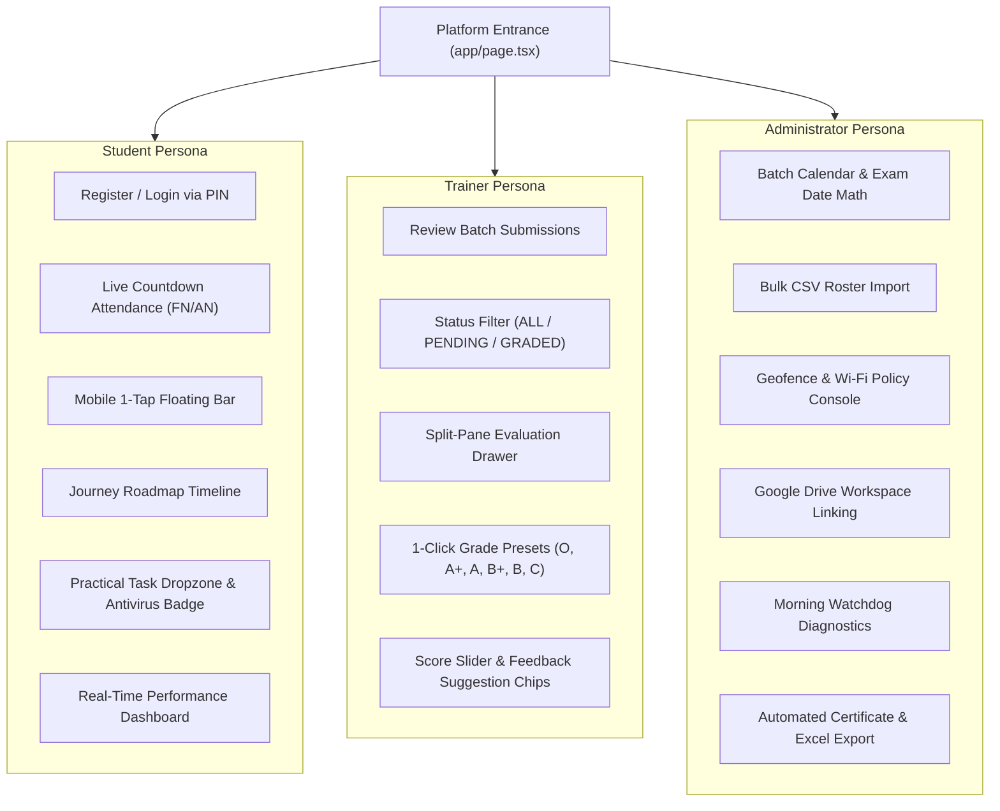

# Project Overview: AR/VR Academy Platform

**Document ID:** `PROJ-OVER-001`  
**Classification:** System Overview & Functional Capability Register  
**Verification Category:** Verified in source code analysis  

---

## 1. Academy Mission & Value Proposition

The AR/VR Academy Platform serves as the central learning management and operational nervous system for immersive spatial computing education. In spatial computing training (Unity XR Interaction Toolkit, Meta Quest Passthrough, Apple visionOS development, WebXR), physical presence in the hardware lab is mandatory. 

The platform guarantees institutional credibility through:
1. **Physical Geofenced Attendance:** Automated verification ensuring students are physically present in the lab during Forenoon (FN) and Afternoon (AN) windows before task submission is unlocked.
2. **Interactive Curriculum Roadmap:** 10-day progressive milestone timeline guiding students from basic scene setups to full spatial interactors and capstone examinations.
3. **Evidence-Based Evaluation:** Direct screenshot and build artifact reviews with instant feedback and grade presets.
4. **Automated Completion & Certification:** Enforces institutional attendance thresholds ($\ge 75\%$ or $100\%$) and exam completion rules to issue tamper-proof certificate serial numbers.

---

## 2. Portal Breakdown & User Personas

