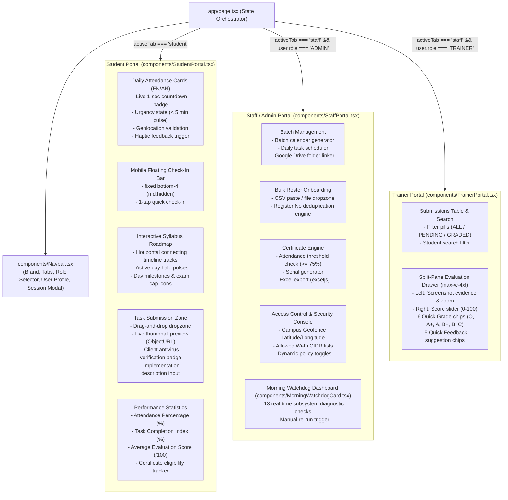

# Component Architecture & Frontend-Backend Traceability

**Document ID:** `ARCH-COMP-003`  
**Classification:** Software Component Architecture  
**Verification Category:** Verified in source (`components/**`, `app/**`, `lib/**`)  

---

## 1. Frontend Component Hierarchy

---

## 2. Component Specification Matrix

| Component | Path | State Variables | Primary Downstream APIs | Error Boundaries / Skeletons |
| :--- | :--- | :--- | :--- | :--- |
| **`Navbar`** | [`components/Navbar.tsx`](file:///Users/livesh/arvr/ARVR/components/Navbar.tsx) | `activeTab`, `showProfileModal` | `/api/auth/me`, `/api/auth/logout` | Inline fallback badge |
| **`StudentPortal`** | [`components/StudentPortal.tsx`](file:///Users/livesh/arvr/ARVR/components/StudentPortal.tsx) | `currentSubTab`, `clockNow`, `attendanceStatus`, `selectedFile`, `previewUrl`, `tasks` | `/api/student/attendance/[session]`, `/api/student/task/today`, `/api/student/task/submit`, `/api/student/curriculum`, `/api/student/progress` | `CurriculumSkeleton`, `StatsCardsSkeleton` |
| **`StaffPortal`** | [`components/StaffPortal.tsx`](file:///Users/livesh/arvr/ARVR/components/StaffPortal.tsx) | `batches`, `activeBatchId`, `students`, `csvInput`, `systemSettings`, `diagnosticReport` | `/api/admin/batches`, `/api/admin/students`, `/api/admin/students/import`, `/api/admin/settings/*`, `/api/admin/stats` | `BatchCardsSkeleton`, `TableSkeleton` |
| **`TrainerPortal`** | [`components/TrainerPortal.tsx`](file:///Users/livesh/arvr/ARVR/components/TrainerPortal.tsx) | `searchTerm`, `statusFilter`, `selectedSubmission`, `score`, `grade`, `feedbackComments` | `/api/trainer/batches`, `/api/trainer/batches/[batchId]/tasks`, `/api/trainer/evaluations` | `TableSkeleton` |
| **`MorningWatchdogCard`** | [`components/MorningWatchdogCard.tsx`](file:///Users/livesh/arvr/ARVR/components/MorningWatchdogCard.tsx) | `report`, `runningCheck` | `/api/cron/morning-watchdog` | Shimmer pulse card |
| **`EnterpriseAlert`** | [`components/EnterpriseAlert.tsx`](file:///Users/livesh/arvr/ARVR/components/EnterpriseAlert.tsx) | `dismissed` | N/A (Stateless UI Alert Banner) | Inline auto-dismiss |
| **`LoadingSkeletons`** | [`components/LoadingSkeletons.tsx`](file:///Users/livesh/arvr/ARVR/components/LoadingSkeletons.tsx) | N/A | N/A | Pure CSS shimmer wrappers |
