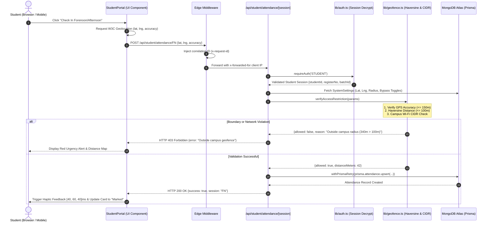
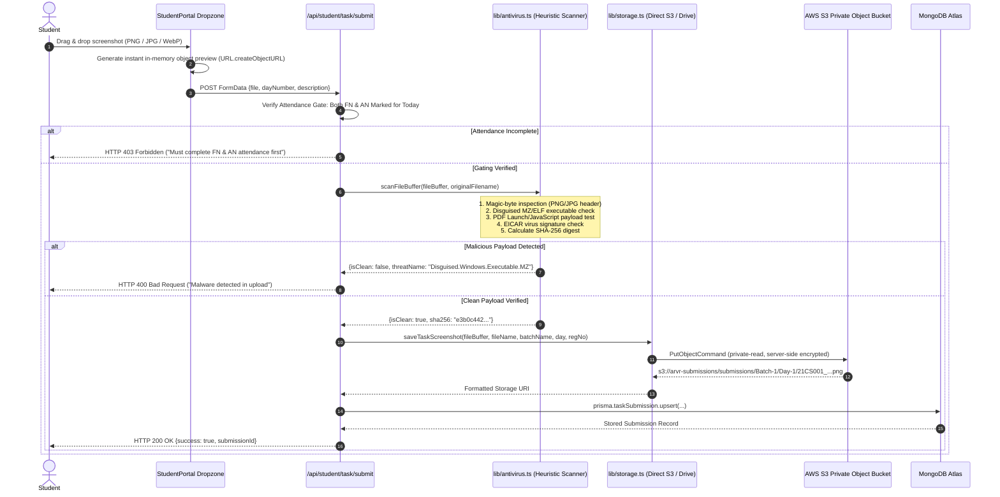
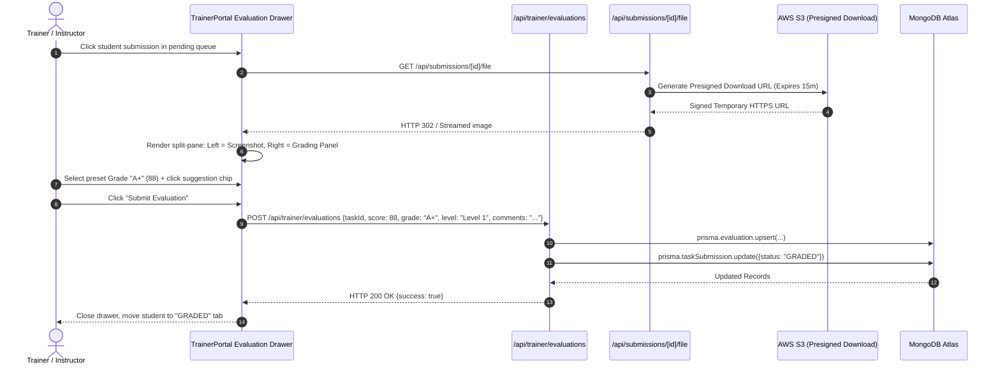

# End-to-End System Data Flows

**Document ID:** `ARCH-FLOW-004`  
**Classification:** Information & Transactional Data Flow  
**Verification Category:** Verified in source (`StudentPortal.tsx`, `api/student/attendance`, `api/student/task/submit`, `lib/antivirus.ts`, `lib/storage.ts`)  

---

## 1. Student Attendance Check-In Sequence

---

## 2. Practical Task Screenshot Upload & Zero-Trust Inspection

---

## 3. Trainer Evaluation & Grading Flow

