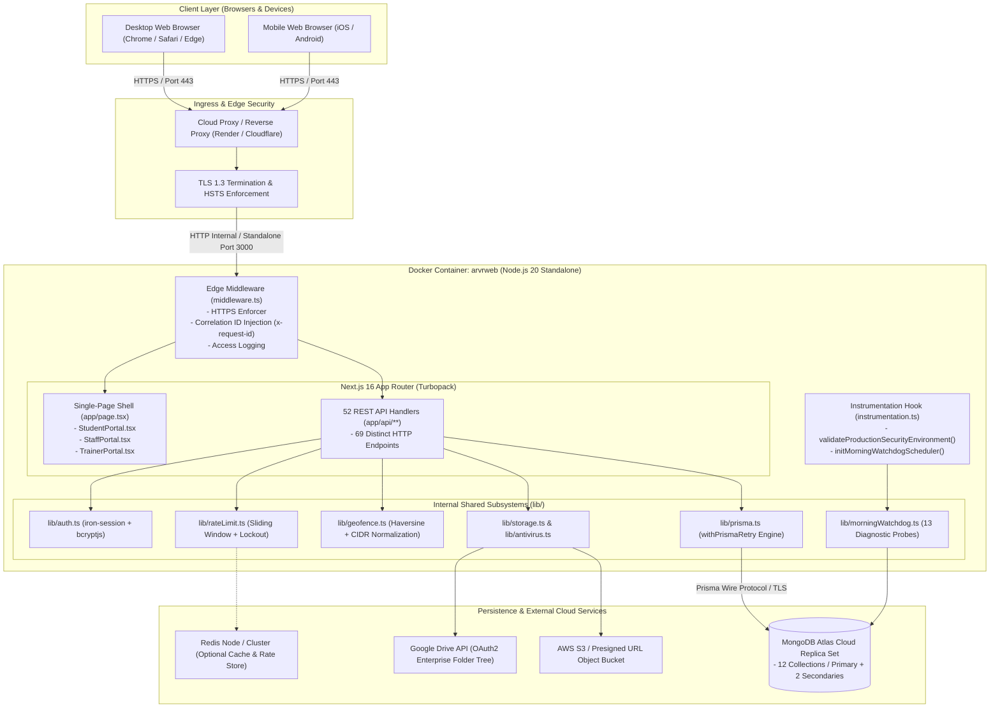

# System Architecture & Technical Topology

**Document ID:** `ARCH-SYS-002`  
**Classification:** Core System Architecture  
**Verification Category:** Verified in source (`Dockerfile`, `next.config.ts`, `middleware.ts`, `instrumentation.ts`)  

---

## 1. Container & Deployment Architecture

---

## 2. Layer Responsibilities & Implementation Files

### 2.1 Ingress & Middleware Layer
- **Files:** [`middleware.ts`](file:///Users/livesh/arvr/ARVR/middleware.ts), [`next.config.ts`](file:///Users/livesh/arvr/ARVR/next.config.ts)
- **Functions:**
  - Enforces HTTPS for public traffic with permanent redirects.
  - Generates or extracts `x-request-id` (UUIDv4) and injects it into request headers and response headers.
  - Extracts and normalizes client IP from `x-forwarded-for`.
  - Dispatches structured console access logs `[HTTP_REQUEST]` for all non-static requests.
  - Applies Strict-Transport-Security, X-Frame-Options (`DENY`), X-Content-Type-Options (`nosniff`), Referrer-Policy, and Permissions-Policy.

### 2.2 Application Shell & Presentation Layer
- **Files:** [`app/layout.tsx`](file:///Users/livesh/arvr/ARVR/app/layout.tsx), [`app/page.tsx`](file:///Users/livesh/arvr/ARVR/app/page.tsx), [`app/globals.css`](file:///Users/livesh/arvr/ARVR/app/globals.css)
- **Architecture:** Client-side hydrated SPA on top of Next.js server-rendered shell.
- **Portals Managed:**
  - `StudentPortal`: Learning hub, daily tasks, geofenced attendance, horizontal syllabus roadmap, mobile floating bar.
  - `StaffPortal`: Admin command center, batch configuration, roster imports, settings, watchdog diagnostics, certificate generation.
  - `TrainerPortal`: Evaluator portal, split-pane submission review drawer, score slider, grade chips, feedback insertion.

### 2.3 API Routing & Controller Layer
- **Path:** [`app/api/**`](file:///Users/livesh/arvr/ARVR/app/api)
- **Structure:** 52 distinct route files exposing 69 HTTP methods.
- **Payload Handling:** Standard JSON for transactional payloads and multipart/form-data for task submission uploads.
- **Security Check:** All mutations and private reads invoke `requireAuth(role)` from `lib/auth.ts`.

### 2.4 Data Access & Retry Layer
- **File:** [`lib/prisma.ts`](file:///Users/livesh/arvr/ARVR/lib/prisma.ts)
- **Engine:** Prisma ORM connected to MongoDB Atlas.
- **Resilience (`withPrismaRetry`):**
  - Executes queries inside an exponential backoff loop (up to 3 retries, base delay 200ms).
  - Automatically intercepts transient MongoDB connection dropouts (`P2024`, `P2010`, `PoolTimeout`, `ServerSelectionTimeout`) to maintain zero-downtime student check-in spikes.
