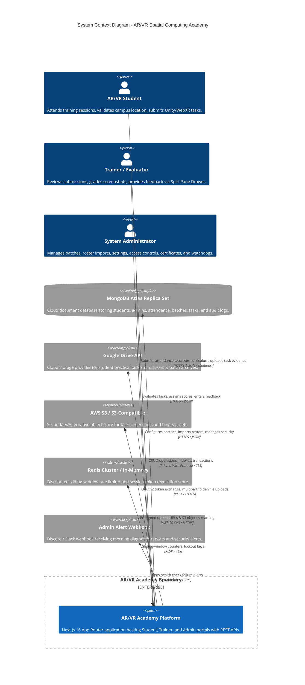

# System Context: AR/VR Academy Platform

**Document ID:** `ARCH-CTX-001`  
**Classification:** Technical Architecture  
**Verification Category:** Verified in source & live environment  
**Target System:** AR/VR Academy Spatial Computing LMS (`LMS_System`)  

---

## 1. High-Level System Context Diagram

---

## 2. External Actors & Interactions

### 2.1 Primary Actors

| Actor | Access Mechanism | Authentication Method | Core Capabilities |
| :--- | :--- | :--- | :--- |
| **Student** | Web Browser / Mobile Browser | Register Number + 6-digit PIN (`iron-session` cookie) | View curriculum roadmap, mark Forenoon/Afternoon attendance with GPS/Wi-Fi verification, submit practical task screenshots, view evaluation scores and feedback. |
| **Trainer** | Web Browser / Tablet | Email + Password (Bcrypt hash) | View assigned batch students, filter pending task submissions, inspect student screenshot evidence in split-pane drawer, assign grades and preset feedback. |
| **Administrator** | Web Browser Desktop | Email + Password + Optional 2FA TOTP | Configure training batches, generate daily calendars, bulk import student rosters via CSV, toggle campus geofencing/Wi-Fi bypass rules, export Excel gradebooks, trigger morning watchdogs. |

---

## 3. External Systems & Trust Relationships

### 3.1 MongoDB Atlas Cluster
- **Role:** Primary System of Record.
- **Protocol:** `mongodb+srv://` over TLS 1.3 with SCRAM-SHA-256 authentication.
- **Topology:** 3-node replica set (1 Primary + 2 Secondary replicas) with automated sub-5-second failover.
- **Data Encrypted:** In-transit via TLS and at-rest via MongoDB Atlas volume encryption.

### 3.2 Google Drive API Integration
- **Role:** Primary cloud storage provider for student submission screenshots and batch folders.
- **Protocol:** Google APIs REST v3 over HTTPS.
- **Authentication:** OAuth2 with offline access, client credentials (`GOOGLE_CLIENT_ID`, `GOOGLE_CLIENT_SECRET`), and AES-256 encrypted refresh tokens stored in `GoogleDriveConnection` table.

### 3.3 AWS S3 / Object Store Integration
- **Role:** High-throughput secondary or air-gapped storage for task submissions and resources.
- **Protocol:** AWS SDK v3 with SigV4 signatures over HTTPS.
- **Capabilities:** Direct server upload and secure Presigned URL generation for client-direct uploads.

### 3.4 In-Memory / Distributed Redis Store
- **Role:** Sliding-window rate limiting (`lib/rateLimit.ts`) and revoked session token cache.
- **Resilience:** Graceful in-memory fallback if Redis is unavailable or unconfigured, preventing service outages while maintaining local sliding-window protection.

### 3.5 Alerting Webhook
- **Role:** Dispatch operational health diagnostics from `runMorningWatchdog()` when critical subsystems (DB, S3, OAuth, Curriculum consistency) degrade.
