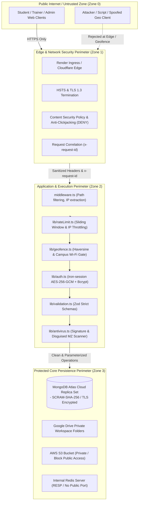

# Security Trust Boundaries & Perimeters

**Document ID:** `ARCH-TRB-005`  
**Classification:** Security Architecture & Threat Boundaries  
**Verification Category:** Verified in source (`middleware.ts`, `lib/auth.ts`, `lib/geofence.ts`, `lib/antivirus.ts`, `next.config.ts`)  

---

## 1. Trust Boundaries Diagram

---

## 2. Perimeter Enforcement Mechanisms

### Boundary 1: Untrusted Client -> Edge Perimeter (Zone 0 to Zone 1)
- **Protocol Enforced:** Strict HTTPS. HTTP traffic is redirected with permanent `301` in production.
- **Header Hardening:**
  - `X-Frame-Options: DENY` blocks embedding in foreign iframes (Clickjacking immunity).
  - `X-Content-Type-Options: nosniff` forces strict MIME adherence.
  - Strict CSP (`default-src 'self'`) restricts external asset and script injections.
  - `Permissions-Policy` disables camera and microphone, allowing only self-scoped geolocation.

### Boundary 2: Edge Perimeter -> Application Core (Zone 1 to Zone 2)
- **Rate-Limiting Barrier:** Dual-layered IP and account throttling blocks brute-force authentication attempts.
- **Physical Campus Perimeter:**
  - GPS verification requires coordinate reporting with accuracy $\le 150\text{m}$.
  - Haversine distance must fall within the configured campus radius ($\le 100\text{m}$).
  - Authorized Wi-Fi network egress IP must match campus CIDR blocks unless an administrative override is active.
- **Zero-Trust File Ingestion:** Every multipart upload is buffered in memory, analyzed for magic bytes, checked against EICAR and Windows/Linux executable headers, and hashed (SHA-256) before writing to persistent storage.

### Boundary 3: Application Core -> Persistence Backbone (Zone 2 to Zone 3)
- **No Direct Public Database Exposure:** MongoDB Atlas is accessible exclusively via TLS with SCRAM-SHA-256 credentials over a private database connection string.
- **Private S3 Storage:** AWS S3 buckets enforce **Block Public Access**. Files can only be downloaded via temporary presigned URLs or authenticated backend streaming proxies (`/api/submissions/[id]/file`).
- **Encrypted OAuth Tokens:** Google Drive refresh tokens are encrypted at-rest using AES-256 before storage in MongoDB.
