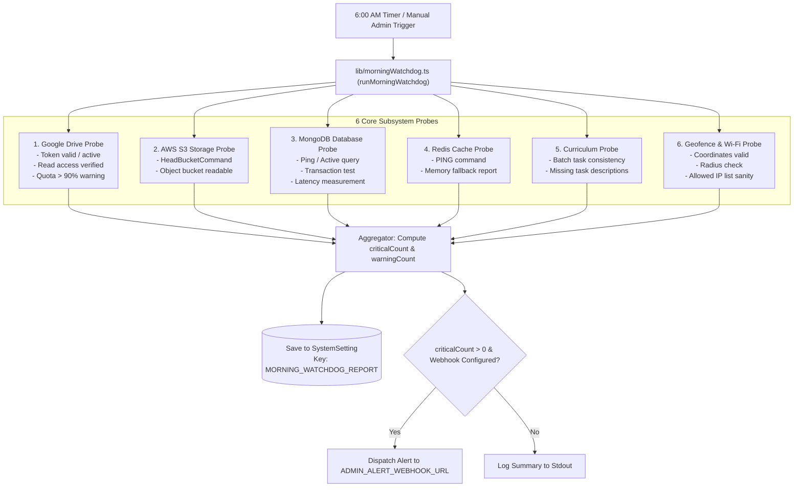

# Background Jobs, Watchdogs & Scheduled Tasks

**Document ID:** `BACK-JOB-004`  
**Classification:** Operational Scheduling & Health Automation  
**Verification Category:** Verified in source (`instrumentation.ts`, `lib/cronScheduler.ts`, `lib/morningWatchdog.ts`, `app/api/cron/morning-watchdog/route.ts`)  

---

## 1. Automated 6:00 AM Morning Watchdog

### 1.1 Trigger & Lifecycle
- **Initialization Hook:** [`instrumentation.ts`](file:///Users/livesh/arvr/ARVR/instrumentation.ts) registers `initMorningWatchdogScheduler()` on server startup in Node.js runtime.
- **Timing Logic:** [`lib/cronScheduler.ts`](file:///Users/livesh/arvr/ARVR/lib/cronScheduler.ts) calculates `getMsUntilNext6AM()` and sets a timer targeting 06:00:00 every morning.
- **Self-Healing Loop:** Recursively schedules the next 24-hour cycle upon completion.
- **On-Demand Manual Trigger:** Administrators can trigger the check immediately from the Staff Portal dashboard or via authenticated POST:
  ```http
  POST /api/cron/morning-watchdog
  Authorization: Bearer <CRON_SECRET>
  ```

---

## 2. The 6 Subsystem Diagnostic Probes



---

## 3. Webhook Alert Payload Schema

When a critical health failure is detected, the watchdog posts a Discord/Slack-compatible JSON payload:

```json
{
  "content": "🚨 **[AR/VR Academy Morning Health Alert]**\nSubsystems degraded before morning classes start:\n- **Google Drive**: Token has expired. Please reconnect in Staff Portal.\n- **AWS S3**: Bucket unreachable.",
  "embeds": [
    {
      "title": "Subsystem Health Status",
      "color": 15158332,
      "fields": [
        { "name": "Google Drive", "value": "CRITICAL", "inline": true },
        { "name": "Database", "value": "OK (14ms)", "inline": true },
        { "name": "Geofence", "value": "OK", "inline": true }
      ],
      "timestamp": "2026-10-23T06:00:00.000Z"
    }
  ]
}
```
