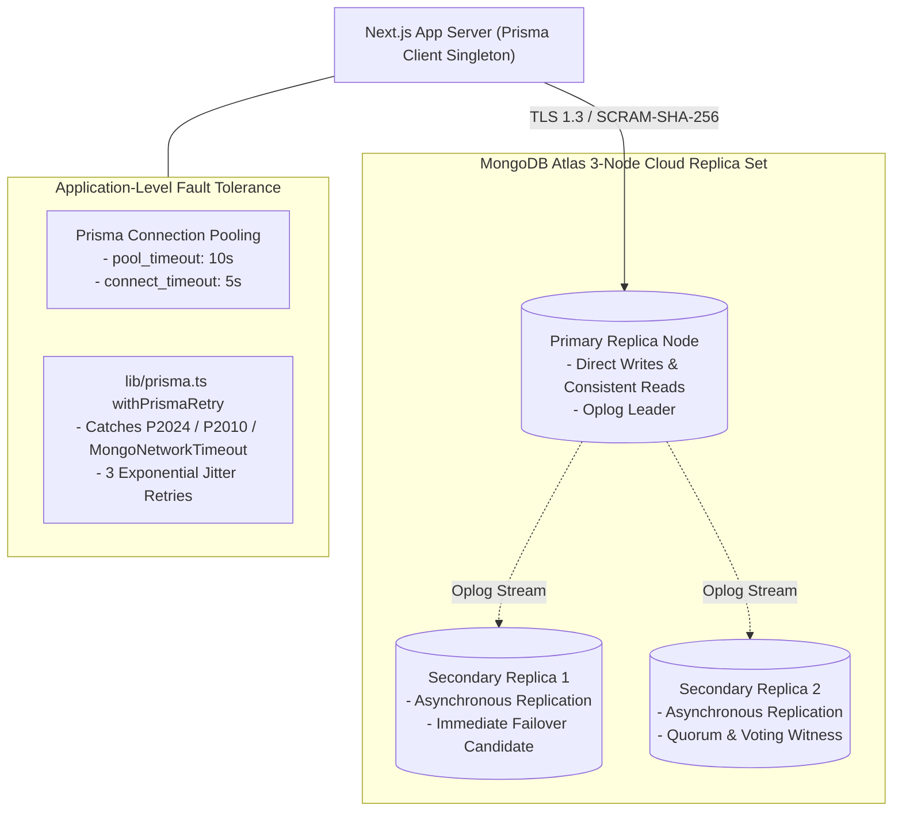

# Database Architecture & Persistence Strategy

**Document ID:** `DB-ARCH-001`  
**Classification:** Database Architecture & Schema Specification  
**Database Engine:** MongoDB Atlas (Cloud Replica Set) / MongoDB 4.4+  
**Access Layer:** Prisma ORM 6.4 (`provider = "mongodb"`)  
**Datasource URI:** `env("DATABASE_URL")` (`mongodb+srv://...`)  
**Verification Category:** Verified in source (`prisma/schema.prisma`, `lib/prisma.ts`) & verified live in staging  

---

## 1. Persistence Topology & High Availability

The AR/VR Academy platform connects to a high-availability MongoDB Atlas replica set configured for production and staging workloads:

### 1.1 Connection Lifecycle & Pooling
- **Prisma Connection String:** Configured via `DATABASE_URL` with query string parameters:
  `retryWrites=true&w=majority&appName=ARVR-Staging`
- **Singleton Handling:** Global client caching in `globalThis.prisma` prevents exhaustion of Atlas connection slots during fast refresh in development.
- **Auto-Failover Resilience:** In the event of an Atlas primary node election or network partition, `withPrismaRetry` traps transient connection dropouts and retries with exponential backoff (200ms, 400ms, 800ms + random jitter), ensuring active student check-ins do not drop.

---

## 2. Collection & Entity Architecture

The schema defines **12 distinct models** in `prisma/schema.prisma`, using native MongoDB `ObjectId` primary keys (`@id @default(auto()) @map("_id") @db.ObjectId`):

| Collection Name | Prisma Model | Purpose | Primary Consumer |
| :--- | :--- | :--- | :--- |
| **`Student`** | `Student` | Student profile, credentials, enrolled batch, contact metadata | `StudentPortal`, `StaffPortal` |
| **`Admin`** | `Admin` | Staff, instructors, and system administrators with optional 2FA | `StaffPortal`, `TrainerPortal` |
| **`Batch`** | `Batch` | Cohort metadata, training days count, level, start/end dates | `StaffPortal`, Calendar builder |
| **`TrainingDay`** | `TrainingDay` | Daily syllabus, practical task description, resources, session toggles | `StudentPortal`, Curriculum |
| **`Attendance`** | `Attendance` | Forenoon and Afternoon check-in records with timestamps | Geofence engine, StudentPortal |
| **`TaskSubmission`**| `TaskSubmission`| Screenshot evidence, S3/Drive storage pointers, antivirus status | StudentPortal, TrainerPortal |
| **`Evaluation`** | `Evaluation` | Numerical scores, letter grades, training levels, and comments | TrainerPortal, Gradebook |
| **`Feedback`** | `Feedback` | Student learning feedback and suggestions | StudentPortal, Admin review |
| **`CertificateRecord`**| `CertificateRecord`| Official certificate numbers, completion dates, override flags | Certificate Engine, Excel export |
| **`SystemSetting`** | `SystemSetting` | Dynamic key-value configuration (Geofence lat/lng, thresholds) | `lib/settings.ts`, Watchdog |
| **`GoogleDriveConnection`**| `GoogleDriveConnection`| OAuth2 encrypted refresh tokens and root folder IDs | `lib/googleDrive.ts` |
| **`AuditLog`** | `AuditLog` | Immutable security audit trail of administrative mutations | `lib/auditLog.ts`, Compliance |
