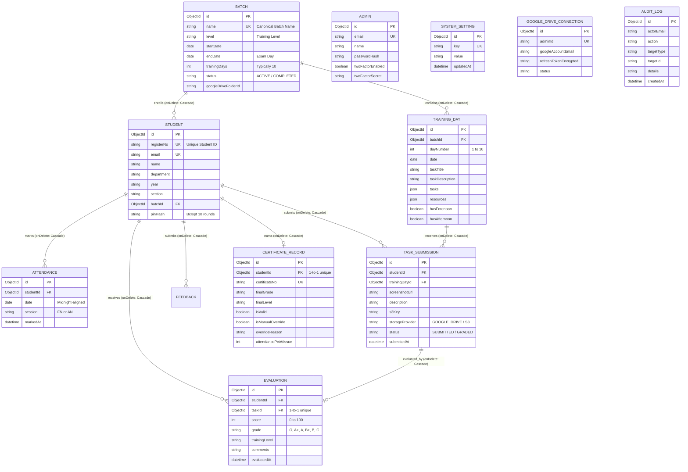

# Entity Relationship Diagram & Relational Semantics

**Document ID:** `DB-ERD-003`  
**Classification:** Relational Structure & Foreign Keys  
**Verification Category:** Verified in source (`prisma/schema.prisma`)  

---

## 1. Entity-Relationship Diagram (Mermaid)

---

## 2. Integrity & Cascade Semantics

- **Cascade Deletions (`onDelete: Cascade`):**
  - When a `Batch` is deleted, all enrolled `Student` records and associated `TrainingDay` calendar entries are automatically purged.
  - When a `Student` is deleted, all associated `Attendance`, `TaskSubmission`, `Evaluation`, `CertificateRecord`, and `Feedback` documents are removed, preventing orphaned records in MongoDB.
  - When a `TaskSubmission` is removed, its dependent `Evaluation` is deleted.
- **Unique Compound Constraints:**
  - `TrainingDay`: `[batchId, dayNumber]` prevents duplicate day numbers within the same batch.
  - `Attendance`: `[studentId, date, session]` strictly prevents duplicate check-ins for the same student in the same Forenoon or Afternoon window.
  - `TaskSubmission`: `[studentId, trainingDayId]` enforces one submission per practical day per student.
