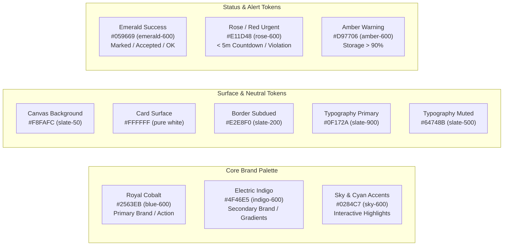

# Design System: Royal Cobalt & Electric Indigo

**Document ID:** `FRONT-DS-001`  
**Classification:** Frontend Design Tokens & UI Aesthetics  
**Verification Category:** Verified in source (`app/globals.css`, `components/Navbar.tsx`, `components/StudentPortal.tsx`, `components/TrainerPortal.tsx`)  

---

## 1. Palette Architecture & Color Tokens

The visual foundation is anchored by **Royal Cobalt (`#2563EB`)** and **Electric Indigo (`#4F46E5`)**, paired with a subtle spatial mesh background and glassmorphism cards. Legacy lavender and purple classes have been completely purged across all components.



---

## 2. Typography Specification

- **Primary Font Family:** `Plus Jakarta Sans`, `Inter`, system-ui, sans-serif (imported via Google Fonts CDN in `app/globals.css`).
- **Monospace Font Family:** `ui-monospace`, `SFMono-Regular`, `Menlo`, `Monaco`, `Consolas`, monospace.
- **Hierarchy Scale:**

| Level | Tailwind Class | Font Size / Line Height | Font Weight | Typical Usage |
| :--- | :--- | :--- | :--- | :--- |
| **Display Header** | `text-3xl font-extrabold` | 30px / 36px | 800 | Portal Brand Title, Hero Header |
| **Section Header** | `text-xl font-bold` | 20px / 28px | 700 | Card Headings, Drawer Headers |
| **Subheading** | `text-sm font-semibold` | 14px / 20px | 600 | Tab Titles, Column Labels |
| **Body Text** | `text-sm font-normal` | 14px / 20px | 400 | Description, Notes, Helper Text |
| **Micro Caption** | `text-xs font-medium` | 12px / 16px | 500 | Countdown Badges, Metadata Chips |

---

## 3. Elevation & Glassmorphism Utilities

### 3.1 `.spatial-grid-bg`
```css
.spatial-grid-bg {
  background-size: 32px 32px;
  background-image: 
    linear-gradient(to right, rgba(37, 99, 235, 0.04) 1px, transparent 1px),
    linear-gradient(to bottom, rgba(37, 99, 235, 0.04) 1px, transparent 1px);
}
```
Provides a modern holographic blueprint feel appropriate for spatial computing and 3D engine training.

### 3.2 `.glass-card` & `.glass-card-hover`
```css
.glass-card {
  background: rgba(255, 255, 255, 0.85);
  backdrop-filter: blur(16px);
  -webkit-backdrop-filter: blur(16px);
  border: 1px solid rgba(226, 232, 240, 0.8);
  box-shadow: 0 10px 30px -5px rgba(37, 99, 235, 0.06), 0 2px 8px rgba(0, 0, 0, 0.02);
}
```

### 3.3 `.pro-button-primary`
Interactive gradient button with subtle depth elevation:
- Default: `linear-gradient(135deg, #2563eb 0%, #4f46e5 100%)` with `box-shadow: 0 4px 14px 0 rgba(37, 99, 235, 0.35)`
- Hover: Translates `translateY(-1px)` with `box-shadow: 0 6px 20px 0 rgba(37, 99, 235, 0.45)`.
- Active: Translates `translateY(0)`.

### 3.4 `.timeline-track` & `.animate-pulse-glow`
Horizontal roadmap timeline connecting track with 3px `#e2e8f0` stroke, and dynamic 2-second radiating pulse animation for active nodes and urgent attendance states.
