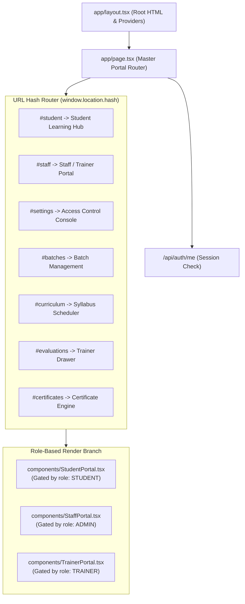

# Application Navigation, Routes & Single-Page Shell

**Document ID:** `FRONT-NAV-002`  
**Classification:** Navigation & Page Topology  
**Verification Category:** Verified in source (`app/page.tsx`, `app/layout.tsx`, `components/Navbar.tsx`)  

---

## 1. Single-Page Architecture & Route Topology

The application is structured as an enterprise Single-Page Shell driven by Next.js 16 App Router. Rather than full browser page reloads, transitions between the Student, Trainer, and Admin environments occur via client state orchestration with bidirectional URL hash synchronization:

---

## 2. Route & Hash Directory

| Navigation Target | URL Path / Hash | Required Role | State Component | Features Accessible |
| :--- | :--- | :--- | :--- | :--- |
| **Public Landing / Student** | `/` or `/#student` | None (Public) / `STUDENT` | [`StudentPortal.tsx`](file:///Users/livesh/arvr/ARVR/components/StudentPortal.tsx) | Student registration, PIN authentication, daily attendance cards, syllabus timeline, task submission dropzone, performance statistics. |
| **Staff & Trainer Entrance** | `/#staff` | `ADMIN` or `TRAINER` | [`StaffPortal.tsx`](file:///Users/livesh/arvr/ARVR/components/StaffPortal.tsx) | Unified login form for instructors and system administrators. |
| **Trainer Evaluation Queue** | `/#evaluations` | `TRAINER` or `ADMIN` | [`TrainerPortal.tsx`](file:///Users/livesh/arvr/ARVR/components/TrainerPortal.tsx) | Search submissions, filter pending tasks, split-pane screenshot evaluation drawer, score slider, preset grade chips. |
| **Batch Management** | `/#batches` | `ADMIN` | [`StaffPortal.tsx`](file:///Users/livesh/arvr/ARVR/components/StaffPortal.tsx) | Create batches, generate calendars, assign trainers, inspect batch progress. |
| **Curriculum Configurator**| `/#curriculum` | `ADMIN` | [`StaffPortal.tsx`](file:///Users/livesh/arvr/ARVR/components/StaffPortal.tsx) | Edit 10-day practical tasks, assign Unity XR and WebXR documentation links. |
| **Roster Bulk Onboarding** | `/#students` | `ADMIN` | [`StaffPortal.tsx`](file:///Users/livesh/arvr/ARVR/components/StaffPortal.tsx) | Paste or upload CSV student rosters with duplicate register number detection. |
| **Certificate Engine** | `/#certificates` | `ADMIN` | [`StaffPortal.tsx`](file:///Users/livesh/arvr/ARVR/components/StaffPortal.tsx) | Verification of 100% attendance & exam criteria, atomic serial generation, Excel export. |
| **Access Control Console** | `/#settings` | `ADMIN` | [`StaffPortal.tsx`](file:///Users/livesh/arvr/ARVR/components/StaffPortal.tsx) | Geofence coordinates, radius, allowed Wi-Fi CIDRs, Google Drive OAuth linking. |

---

## 3. Deep Linking & State Transitions

1. **Hash Change Listener:** [`app/page.tsx:28-60`](file:///Users/livesh/arvr/ARVR/app/page.tsx) attaches a `hashchange` event listener on mount. If the URL hash matches any administrative keyword (`staff`, `admin`, `evaluations`, etc.), `activeTab` transitions seamlessly to `'staff'`.
2. **Branding Updates:** Listens for `window.addEventListener('branding-updated')`. When administrative settings change the enterprise title, subtitle, or organization name, the page title and browser tab header (`document.title`) synchronize dynamically across all open browser tabs without reloading.
3. **Session Authentication Handshake:** On initial load, [`app/page.tsx:84`](file:///Users/livesh/arvr/ARVR/app/page.tsx) fires a non-blocking `GET /api/auth/me`. While verifying, [`PageLoadingScreen`](file:///Users/livesh/arvr/ARVR/components/LoadingSkeletons.tsx) displays animated shimmer branding.
