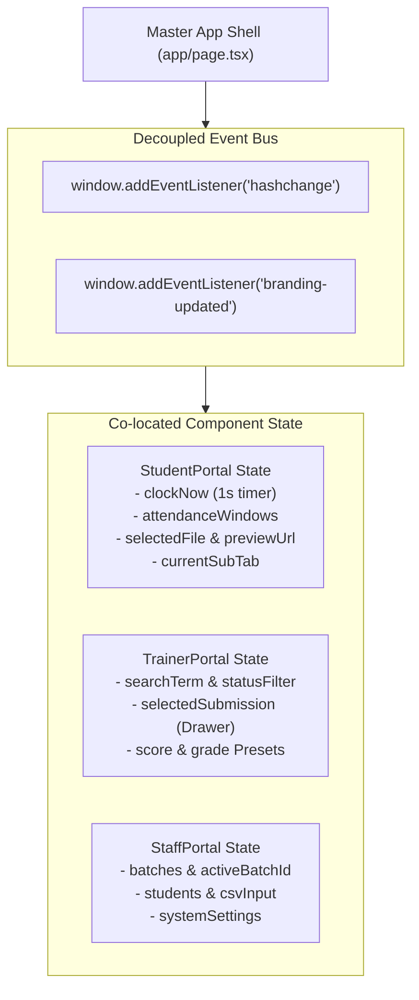

# Frontend State Management & React Lifecycle

**Document ID:** `FRONT-STATE-004`  
**Classification:** Client Architecture & State Flow  
**Verification Category:** Verified in source (`app/page.tsx`, `StudentPortal.tsx`, `StaffPortal.tsx`, `TrainerPortal.tsx`)  

---

## 1. Client State Architecture

Rather than relying on heavyweight external state containers (such as Redux or MobX), the platform leverages React 19 native hooks (`useState`, `useEffect`, `useCallback`, `useMemo`) combined with browser primitives (`URL.createObjectURL`, `window.location.hash`, `navigator.vibrate`, and custom DOM events) to maintain performance and reactivity.



---

## 2. Real-Time Attendance Clock & Ticking Intervals

In [`StudentPortal.tsx`](file:///Users/livesh/arvr/ARVR/components/StudentPortal.tsx), attendance session remaining time is computed via an isolated 1-second interval:

```typescript
useEffect(() => {
  const timer = setInterval(() => {
    setClockNow(new Date());
  }, 1000);
  return () => clearInterval(timer);
}, []);
```

### 2.1 Countdown Computation Algorithm
`getSessionRemaining(sessionDetails)` executes every tick:
1. Converts the session's scheduled cutoff time (e.g., `09:00` or `13:10`) into minutes elapsed since midnight.
2. Compares against current local time (`clockNow.getHours() * 60 + clockNow.getMinutes()`).
3. Computes exact remaining minutes and seconds.
4. If remaining time $< 5\text{ minutes}$, flags `isUrgent = true`, activating `.animate-pulse-glow` and red border styling.

---

## 3. Ephemeral Image Previews & Memory Cleanup

When a student selects a practical task screenshot in the dropzone:
1. `URL.createObjectURL(file)` generates a blob URI for instant image rendering without uploading to the server first.
2. When the user removes the file or replaces it, `URL.revokeObjectURL(previewUrl)` releases browser RAM.
3. On component unmount, `previewUrl` is cleaned up automatically via `useEffect` cleanup hook.
