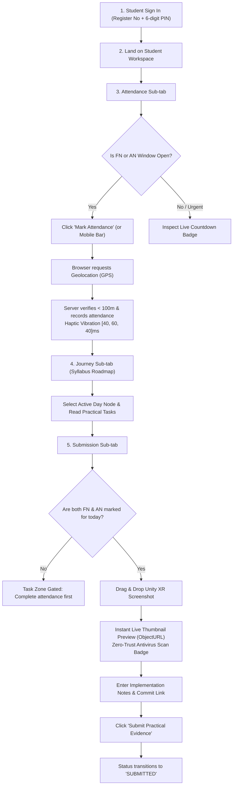
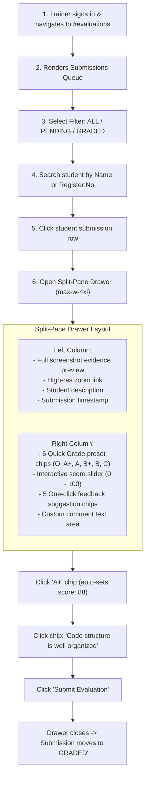

# End-to-End User Interface Workflows

**Document ID:** `FRONT-WORK-005`  
**Classification:** User Experience & Interaction Specifications  
**Verification Category:** Verified in source (`StudentPortal.tsx`, `TrainerPortal.tsx`, `StaffPortal.tsx`)  

---

## 1. Student Daily Learning & Submission Workflow

---

## 2. Trainer Split-Pane Evaluation Workflow

---

## 3. Administrator Batch & Certificate Workflow

1. **Batch Creation:** Admin opens `/#batches`, inputs Batch Name, Level (`Level 1`, `Level 2`, `Level 3`), start date, and training days count.
2. **Calendar Auto-Generation:** System calculates batch end date ($D_N = \text{startDate} + N - 1$), tags the final day as the Final Examination, and populates the 10-day curriculum.
3. **Roster Bulk Import:** Admin opens `/#students`, pastes a CSV table or uploads a file. System validates email and register number format, filters duplicate entries, and enrolls the class in 1 transaction.
4. **Attendance Threshold & Completion Auditor:** Admin opens `/#certificates` and clicks "Run Completion Audit". System checks if students achieved $\ge 100\%$ attendance and completed the Final Exam.
5. **Excel Export:** Generates an official multi-column `.xlsx` spreadsheet workbook formatted with Slate-800 header styling, student names, register numbers, dates, final grades, and certificate serials.
