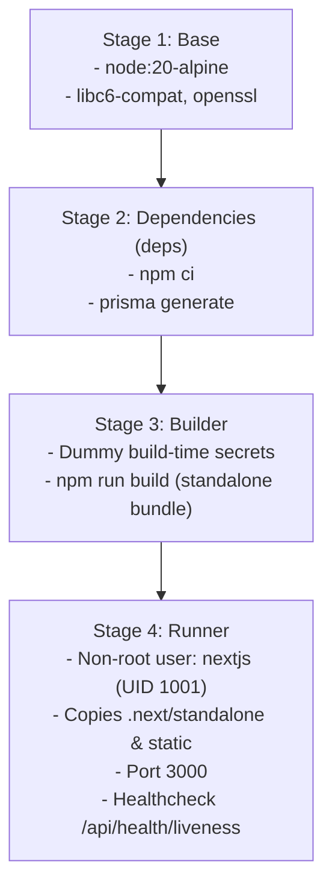

# Production Deployment & Container Runtime Topology

**Document ID:** `OPS-DEP-002`  
**Classification:** Deployment Architecture & Infrastructure  
**Verification Category:** Verified in source (`Dockerfile`, `docker-compose.yml`, `docker-entrypoint.sh`)  

---

## 1. Multi-Stage Docker Architecture

The production image is built with minimal footprint on Alpine Linux:



---

## 2. Container Startup Sequence (`docker-entrypoint.sh`)

```mermaid
sequenceDiagram
    autonumber
    participant Host as Docker Engine / Render
    participant EP as docker-entrypoint.sh
    participant DB as MongoDB Atlas
    participant Server as Next.js Standalone (server.js)

    Host->>EP: Container starts
    EP->>EP: Read DATABASE_URL & DB_WAIT_RETRIES (30)
    EP->>DB: Probe connection socket (2s intervals)
    DB-->>EP: Connection established
    alt SKIP_MIGRATIONS != true
        EP->>DB: Execute 'npx prisma db push --skip-generate'
        DB-->>EP: Schema synchronized
    end
    EP->>DB: Check if Admin exists; auto-seed default admin if database is empty
    EP->>Server: exec node server.js (Replaces PID 1)
    Server-->>Host: Ready on http://0.0.0.0:3000 (Turbopack)
```

---

## 3. Platform Deployment Specifications

### 3.1 Render Web Service (Staging & Production)
- **Environment:** Node.js 20 / Docker.
- **Auto-Deploy:** Enabled on push to `staging` (Staging Service) and `main` (Production Service).
- **Health Check Endpoint:** `/api/health/liveness` (30s interval, 5s timeout).
- **Graceful Shutdown:** `SIGTERM` and `SIGINT` signals propagate directly to `node server.js` ensuring inflight transactions finish within 15 seconds.
