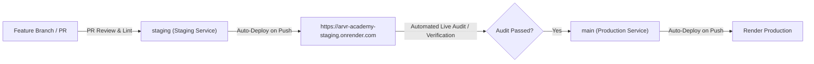

# CI/CD Workflows, Monitoring, Incident Response & Runbooks

**Document ID:** `OPS-OPS-003`  
**Classification:** Operational Runbooks & Release Engineering  
**Verification Category:** Verified in source (`scripts/*`, `deploy/aws/*`)  

---

## 1. Branch Strategy & Release Pipeline



---

## 2. Monitoring & Diagnostic Observability

### 2.1 Health Probes
- **Liveness Probe:** `GET /api/health/liveness` (Returns `200 OK` instantly; used by container orchestrator to restart dead workers).
- **Readiness Probe:** `GET /api/health/readiness` (Performs a lightweight query to verify MongoDB Atlas connection pool readiness before routing incoming HTTP traffic).
- **Deep Health Audit:** `GET /api/health` (Reports memory usage, active connections, and storage state).

### 2.2 Proactive Watchdog Alerting
The 6:00 AM Morning Watchdog tests Google Drive OAuth, S3, MongoDB, Redis, curriculum integrity, and geofence validity. If `criticalCount > 0`, it posts an emergency alert to `ADMIN_ALERT_WEBHOOK_URL` before faculty and students arrive on campus.

---

## 3. Rollback Runbooks

### 3.1 Local Development UI/UX Rollback
If recent UI/UX enhancements (Phases 1–4) need to be rolled back locally:
```bash
# Method A: Instant Git Rollback to pre-enhancement snapshot
git reset --hard pre-ui-ux-phase1-4

# Method B: Restore from local backup directory
cp .backup-ui/globals.css app/
cp .backup-ui/*.tsx components/
```

### 3.2 Staging / Production Remote Rollback
To revert the staging environment to the previous commit:
```bash
git checkout staging
git reset --hard f9a6b78
git push -f origin staging
```
Render automatically detects the force push, triggers a rebuild of commit `f9a6b78`, and completes rollback within 3 minutes.
