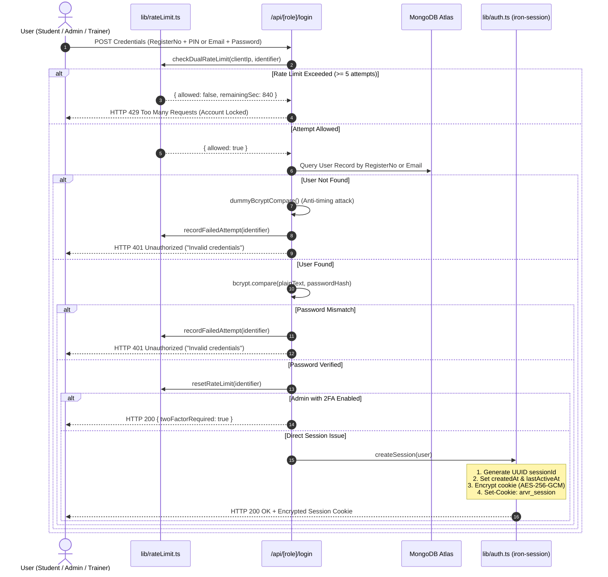

# Authentication, Session Lifecycle & Cryptographic Controls

**Document ID:** `SEC-AUTH-002`  
**Classification:** Cryptography & Identity Verification  
**Verification Category:** Verified in source (`lib/auth.ts`, `lib/rateLimit.ts`, `lib/totp.ts`)  

---

## 1. Authentication Lifecycle

---

## 2. Session Security Rules & Expirations

1. **Cryptographic Storage:** Uses `iron-session` signed with `SESSION_SECRET` (minimum 32-character requirement). Cookies are sealed via AES-256-GCM authenticated encryption.
2. **Idle Expiration:** Inactivity $> 2\text{ hours}$ (`IDLE_TIMEOUT_MS = 7,200,000ms`) automatically destroys the session upon the next request.
3. **Absolute Expiration:**
   - **Student Accounts:** Hard limit of 24 hours (`STUDENT_ABSOLUTE_TIMEOUT_MS = 86,400,000ms`).
   - **Admin Accounts:** Hard limit of 12 hours (`ADMIN_ABSOLUTE_TIMEOUT_MS = 43,200,000ms`).
4. **Session Revocation List:** When `/api/auth/logout` is called, `revokeSession(sessionId)` registers the unique UUID in an in-memory or Redis eviction set for 24 hours. Any replayed copy of the cookie is immediately recognized as revoked and rejected.
5. **Anti-Enumeration & Constant Time Comparison:** When a non-existent student or admin attempts authentication, `lib/security.ts` executes `dummyBcryptCompare()` using a precomputed hash. This ensures response times are identical whether an email exists or not, defeating account enumeration attacks.
