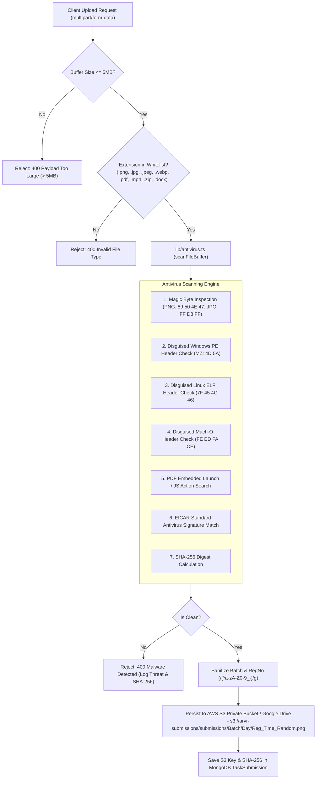

# File Security, Upload Pipelines & Malware Prevention

**Document ID:** `SEC-FILE-005`  
**Classification:** File Handling & Zero-Trust Ingestion  
**Verification Category:** Verified in source (`lib/antivirus.ts`, `lib/storage.ts`, `lib/s3.ts`)  

---

## 1. Zero-Trust File Ingestion Pipeline



---

## 2. Path Traversal & File Name Sanitization

In [`lib/storage.ts`](file:///Users/livesh/arvr/ARVR/lib/storage.ts):
```typescript
const sanitize = (str: string) => str.replace(/[^a-zA-Z0-9_-]/g, '_');
```
All path components (Batch Name, Register Number, and Day Number) are stripped of non-alphanumeric characters, completely neutralizing dot-dot-slash (`../`) directory traversal and null-byte injection attacks.

---

## 3. Storage Permissions & Presigned Downloads

- **Private by Default:** Files uploaded to S3 are stored with private access control. Public bucket read access is disabled (`BlockPublicAcls = true`).
- **Temporary Presigned URLs:** Downloads are generated on-demand via `generatePresignedDownloadUrl(s3Key)` in [`lib/s3.ts`](file:///Users/livesh/arvr/ARVR/lib/s3.ts) with an expiration time of 15 minutes ($900\text{ seconds}$).
- **Streaming Reverse Proxy:** Evaluator access to student screenshots passes through [`app/api/submissions/[id]/file/route.ts`](file:///Users/livesh/arvr/ARVR/app/api/submissions/%5Bid%5D/file/route.ts), requiring an authenticated `ADMIN` or `TRAINER` session before streaming media.
