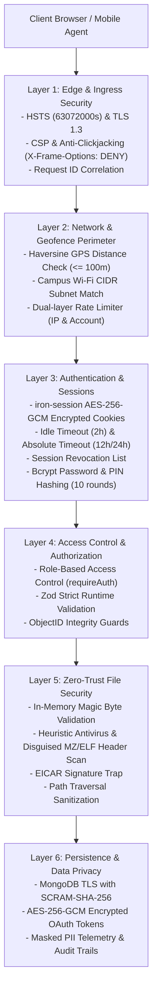

# Security Architecture & Defense-in-Depth Specification

**Document ID:** `SEC-ARCH-001`  
**Classification:** Information Security Architecture  
**Verification Category:** Verified in source (`middleware.ts`, `lib/auth.ts`, `lib/security.ts`, `lib/antivirus.ts`, `next.config.ts`)  

---

## 1. Multi-Layer Defense Architecture

---

## 2. Core Security Controls Summary

| Layer | Primary Defense Mechanism | Source File | Attack Vector Mitigated |
| :--- | :--- | :--- | :--- |
| **Ingress** | Enterprise CSP & Security Headers | [`next.config.ts`](file:///Users/livesh/arvr/ARVR/next.config.ts) | Clickjacking, XSS, MIME confusion, Protocol downgrade |
| **Edge** | HTTPS 301 Enforcement & Correlation | [`middleware.ts`](file:///Users/livesh/arvr/ARVR/middleware.ts) | Plaintext eavesdropping, Man-in-the-Middle |
| **Perimeter**| Geofence GPS & Wi-Fi Verification | [`lib/geofence.ts`](file:///Users/livesh/arvr/ARVR/lib/geofence.ts) | Remote attendance fraud, GPS spoofing |
| **Identity** | Sliding-Window IP/Account Limiter | [`lib/rateLimit.ts`](file:///Users/livesh/arvr/ARVR/lib/rateLimit.ts) | Credential stuffing, brute-force attacks |
| **Session** | Encrypted Cookies & Timeout Enforcer | [`lib/auth.ts`](file:///Users/livesh/arvr/ARVR/lib/auth.ts) | Session hijacking, cookie tampering, zombie sessions |
| **Upload** | Zero-Trust Malware Scanner | [`lib/antivirus.ts`](file:///Users/livesh/arvr/ARVR/lib/antivirus.ts) | Malicious uploads, disguised executables, EICAR tests |
| **Audit** | Immutable Administrative Logging | [`lib/auditLog.ts`](file:///Users/livesh/arvr/ARVR/lib/auditLog.ts) | Unauthorized configuration modifications, repudiation |
