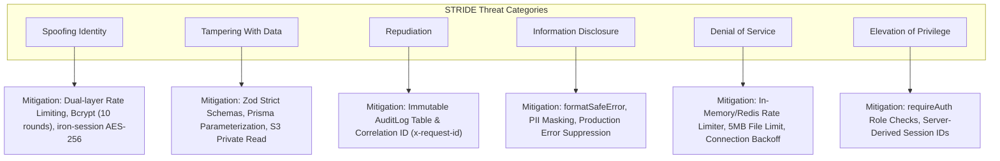

# Security Threat Model & Risk Assessment

**Document ID:** `SEC-THREAT-004`  
**Classification:** STRIDE Security Threat Model  
**Verification Category:** Verified in source & architectural review  

---

## 1. STRIDE Threat Model

---

## 2. Threat Analysis & Verification Matrix

| STRIDE Category | Threat Scenario | Affected Component | Existing Mitigation in Code | Residual Risk | Severity |
| :--- | :--- | :--- | :--- | :---: | :---: |
| **Spoofing** | Attacker brute-forces student 6-digit PIN | `/api/student/login` | Dual-layer sliding window (5 attempts / 60s); 15m lockout on 5th failed attempt (`lib/rateLimit.ts`). | Low | High |
| **Spoofing** | Student spoofs GPS coordinates to fake presence | `/api/student/attendance` | Rejects GPS fixes with accuracy $> 150\text{m}$; calculates Haversine distance ($\le 100\text{m}$); verifies campus Wi-Fi egress CIDR. | Low | High |
| **Tampering** | Attacker uploads web shell disguised as `.png` | `/api/student/task/submit` | Magic byte inspection, EICAR check, disguised Windows PE (`MZ`) and Linux ELF header scanner (`lib/antivirus.ts`). | Low | Critical |
| **Tampering** | SQL/NoSQL Injection in parameters | All API routes | Prisma ORM parameterized queries; Zod schema validation; `isValidObjectId` regex. | Negligible | Critical |
| **Repudiation** | Admin deletes batch or changes grade without trace | `/api/admin/*` | `logAdminAudit()` records actor email, IP address, timestamp, target ID, and action parameters. | Low | Medium |
| **Information**| Database stack trace leaked to client on error | API error handlers | `formatSafeError` in `lib/security.ts` suppresses raw errors in production, returning safe generic strings. | Negligible | High |
| **Denial of Svc**| Distributed spam against login endpoints | Edge Ingress | Sliding window IP limiter; Redis distributed storage fallback; server-side timeouts. | Low | Medium |
| **Elevation** | Student directly invokes Admin Batch API | `/api/admin/batches` | `requireAuth(['ADMIN'])` verifies signed session role token; fails closed with HTTP 401/403. | Negligible | Critical |
