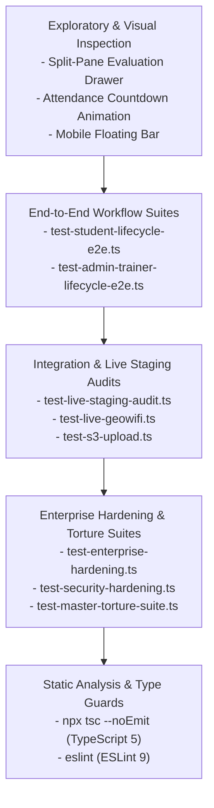

# Testing Strategy, Test Suites & Verification Framework

**Document ID:** `TEST-STRAT-001`  
**Classification:** Quality Assurance & Testing Architecture  
**Verification Category:** Verified in source (`scripts/test-*.ts`) & verified live by test execution  

---

## 1. Testing Pyramid & Verification Layers

---

## 2. Test Suite Catalogue & Automation Scripts

| Script Path | Primary Test Domain | Target Subsystems | Execution Command |
| :--- | :--- | :--- | :--- |
| [`scripts/test-live-staging-audit.ts`](file:///Users/livesh/arvr/ARVR/scripts/test-live-staging-audit.ts) | Live staging environment audit | SSL, HSTS, health endpoints, geofence APIs | `npx tsx scripts/test-live-staging-audit.ts` |
| [`scripts/test-live-geowifi.ts`](file:///Users/livesh/arvr/ARVR/scripts/test-live-geowifi.ts) | Campus geofence & Wi-Fi gate | GPS accuracy, Haversine formula, CIDR filtering | `npx tsx scripts/test-live-geowifi.ts` |
| [`scripts/test-student-lifecycle-e2e.ts`](file:///Users/livesh/arvr/ARVR/scripts/test-student-lifecycle-e2e.ts) | Complete student lifecycle | Registration, login, attendance, task submission | `npx tsx scripts/test-student-lifecycle-e2e.ts` |
| [`scripts/test-admin-trainer-lifecycle-e2e.ts`](file:///Users/livesh/arvr/ARVR/scripts/test-admin-trainer-lifecycle-e2e.ts) | Admin & trainer workflows | Batch creation, roster import, grading, certificates | `npx tsx scripts/test-admin-trainer-lifecycle-e2e.ts` |
| [`scripts/test-security-hardening.ts`](file:///Users/livesh/arvr/ARVR/scripts/test-security-hardening.ts) | Security threat verification | Brute force, timing attacks, path traversal, injection | `npm run test:security` |
| [`scripts/test-enterprise-hardening.ts`](file:///Users/livesh/arvr/ARVR/scripts/test-enterprise-hardening.ts) | Antivirus & zero-trust upload | EICAR signature, disguised MZ/ELF headers, magic bytes | `npm run test:hardening` |
| [`scripts/test-all-features.ts`](file:///Users/livesh/arvr/ARVR/scripts/test-all-features.ts) | Regression test runner | Complete regression pass across all features | `npm test` |
| [`scripts/benchmark-load-test.ts`](file:///Users/livesh/arvr/ARVR/scripts/benchmark-load-test.ts) | Concurrency & load testing | Simulates 100+ concurrent student check-ins | `npx tsx scripts/benchmark-load-test.ts` |
| [`scripts/test-s3-upload.ts`](file:///Users/livesh/arvr/ARVR/scripts/test-s3-upload.ts) | S3 upload & presigned URLs | Multipart upload, signature generation, bucket read | `npm run test:s3` |
