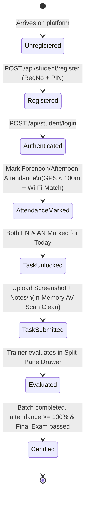
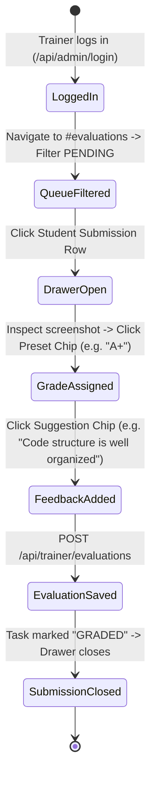

# End-to-End User & Business Workflows

**Document ID:** `WORK-USER-001`  
**Classification:** Business Process Specifications  
**Verification Category:** Verified in source (`StudentPortal.tsx`, `StaffPortal.tsx`, `TrainerPortal.tsx`)  

---

## 1. Student Onboarding, Attendance & Submission Lifecycle

---

## 2. Trainer Split-Pane Grading Lifecycle

---

## 3. Administrator Batch, Curriculum & Certification Lifecycle

1. **Step 1: Batch Inception:** Admin navigates to `/#batches` and creates a new batch. System auto-calculates the end date, marks the final day as the Final Exam, and initializes the curriculum.
2. **Step 2: Roster Ingestion:** Admin uploads CSV roster to `/#students`. System validates emails and register numbers, filters duplicates, hashes default PINs, and enrolls students.
3. **Step 3: Access Control Tuning:** Admin configures geofence coordinates and radius in `/#settings`.
4. **Step 4: Completion Audit:** Admin runs the Completion Audit in `/#certificates`. The engine verifies attendance thresholds and exam attendance, calculates final grades, and issues official serial numbers.
5. **Step 5: Gradebook Export:** Admin downloads the batch report as a styled `.xlsx` workbook.
